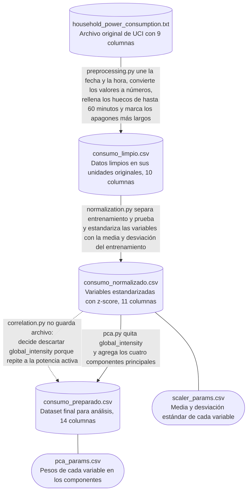

# Práctica 5: Normalización, Reducción de Dimensionalidad y Dashboard

Curso de Almacenes y Minería de Datos — Facultad de Ciencias, UNAM.

## Descripción del proyecto

Preparación de una serie de tiempo de consumo eléctrico doméstico para el
entrenamiento posterior de modelos de regresión y agrupamiento: preprocesamiento
(casteo, deduplicación, faltantes), normalización numérica, reducción de
dimensionalidad (correlación de Pearson y PCA) y un dashboard en Streamlit para
explorar los datos y comunicar hallazgos.

## Contenido

1. [Dataset](#dataset)
2. [Estructura del proyecto](#estructura-del-proyecto)
3. [Instalación](#instalación)
4. [Uso](#uso)
5. [Flujo de los datos](#flujo-de-los-datos)
6. [Resumen de decisiones](#resumen-de-decisiones)

## Dataset

**Individual Household Electric Power Consumption** — UCI Machine Learning Repository.
<https://archive.ics.uci.edu/dataset/235/individual+household+electric+power+consumption>

Las cifras de esta sección se reproducen con `python -m src.eda.inspeccion`; lo
que proviene de la ficha de UCI (origen, unidades, tareas) está en la liga anterior.

### Origen

Mediciones de un solo hogar en Sceaux, Francia (7 km de París), donadas a UCI
el 29 de agosto de 2012 por Georges Hébrail y Alice Bérard. Licencia CC BY 4.0.

### Características

| Característica | Valor |
|---|---|
| Tipo | Multivariado, series de tiempo, variables reales |
| Área temática | Física y Química |
| Tareas asociadas | Regresión, agrupamiento (*clustering*) |
| Registros | 2,075,259 (uno por minuto) |
| Columnas | 9: `Date`, `Time` y 7 variables numéricas |
| Archivo | `household_power_consumption.txt`, separado por `;`, 133.0 MB (126.8 MiB) |
| Faltantes | 25,979 filas (1.25 %), marcadas con `?`|

### Variables

| Variable | Descripción | Unidad |
|---|---|---|
| `Date`, `Time` | Fecha (`dd/mm/yyyy`) y hora (`hh:mm:ss`) de la medición | — |
| `Global_active_power` | Potencia activa global, promedio por minuto | kW |
| `Global_reactive_power` | Potencia reactiva global, promedio por minuto | kW |
| `Voltage` | Voltaje, promedio por minuto | V |
| `Global_intensity` | Intensidad de corriente global, promedio por minuto | A |
| `Sub_metering_1` | Energía activa de la cocina (lavavajillas, horno, microondas) | Wh |
| `Sub_metering_2` | Energía activa del cuarto de lavado (lavadora, secadora, refrigerador, luz) | Wh |
| `Sub_metering_3` | Energía activa del calentador de agua y el aire acondicionado | Wh |

La energía del resto del hogar (no cubierta por los submedidores) se obtiene como
`global_active_power*1000/60 - sub_metering_1 - sub_metering_2 - sub_metering_3` (Wh).

### Naturaleza temporal

- Periodo: 2006-12-16 17:24 a 2010-11-26 21:02 (1,441 días ≈ 47.3 meses).
- Frecuencia fija de 1 minuto, sin huecos en la rejilla temporal: los faltantes
  son filas con `?`, no minutos ausentes.
- El orden de los registros importa: la partición, la normalización y el muestreo
  deben respetar la cronología.

## Estructura del proyecto

```
proyecto/
|-- config/
|   |-- rutas.py             # Rutas centralizadas del proyecto
|-- data/
|   |-- data-raw/            # Archivo original de UCI (no se versiona ni se modifica)
|   |-- data-processed/      # CSV generados por los scripts y parámetros guardados
|-- graphs/                  # Gráficas generadas por los scripts
|-- notebooks/               # Notebooks exploratorios (no productivos)
|-- src/
|   |-- cleaning/            # Preprocesamiento y normalización
|   |-- eda/                 # Análisis exploratorio de datos
|   |-- reduction/           # Correlación de Pearson y PCA
|   |-- dashboard/           # Módulos auxiliares del dashboard
|-- visualization/
|   |-- app.py               # Código principal del dashboard
|-- README.md
|-- requirements.txt
```

## Instalación

### Entorno

```bash
python -m venv venv
source venv/bin/activate
pip install -r requirements.txt
```

### Datos

El archivo original supera los límites de GitHub, por lo que no se incluye en el repositorio.

1. Descargar el `.zip` desde la liga de UCI (sección [Dataset](#dataset)).
2. Descomprimirlo y colocar `household_power_consumption.txt` en `data/data-raw/`.

## Uso

### Procesamiento de los datos

Desde la raíz del proyecto, con el crudo ya en `data/data-raw/`, los scripts se
ejecutan **en este orden** (cada uno lee lo que dejó el anterior):

```bash
python -m src.eda.inspeccion              # 1. Paso 1: inspección del crudo
python -m src.cleaning.preprocessing      # 2. Paso 2: limpieza
python -m src.eda.distribuciones          # 3. EDA: distribuciones y atípicos
python -m src.cleaning.normalization      # 4. Paso 3: z-score
python -m src.reduction.correlation       # 5. Paso 4: Pearson
python -m src.reduction.pca               # 6. Pasos 5 y 6: PCA y dataset preparado
python -m src.reduction.sampling          # 7. Paso 8 (opcional): muestreo
```

| # | Script | Lee | Guarda |
|---|---|---|---|
| 1 | `src/eda/inspeccion.py` | `data-raw/household_power_consumption.txt` | - |
| 2 | `src/cleaning/preprocessing.py` | `data-raw/household_power_consumption.txt` | `data-processed/consumo_limpio.csv` |
| 3 | `src/eda/distribuciones.py` | `consumo_limpio.csv` | `graphs/distribuciones_histogramas.png`, `graphs/distribuciones_boxplots.png` |
| 4 | `src/cleaning/normalization.py` | `consumo_limpio.csv` | `data-processed/consumo_normalizado.csv`, `data-processed/scaler_params.csv` |
| 5 | `src/reduction/correlation.py` | `consumo_normalizado.csv`, `scaler_params.csv` | `graphs/correlacion_heatmap.png`, `graphs/correlacion_dispersion.png` |
| 6 | `src/reduction/pca.py` | `consumo_normalizado.csv`, `scaler_params.csv` | `data-processed/consumo_preparado.csv`, `data-processed/pca_params.csv`, `graphs/pca_scree.png`, `graphs/pca_loadings.png`, `graphs/pca_proyeccion.png` |
| 7 | `src/reduction/sampling.py` | `consumo_limpio.csv` | `data-processed/muestreo_comparacion.csv`, `graphs/muestreo_comparacion.png` |

El script 1 no es obligatorio para generar los datos: solo imprime la inspección
del archivo original que respalda las decisiones. Los que generan los CSV son el
2, el 4, el 6 y el 7, en ese orden. El 7 es el Paso 8 (opcional) y no modifica el
dataset preparado del Paso 6.

### Dashboard

```bash
streamlit run visualization/app.py
```

## Flujo de los datos

Las 2,075,259 filas (un minuto cada una) se conservan en todos los archivos; lo
que cambia son las columnas y sus valores.



Columnas de cada archivo:

| Columna | Crudo | Limpio | Normalizado | Preparado | Qué cambia |
|---|:-:|:-:|:-:|:-:|---|
| `Date`, `Time` | ✓ | | | | Se unen en una sola columna, `datetime` |
| `datetime` | | ✓ | ✓ | ✓ | Fecha y hora de cada minuto |
| `global_active_power` | ✓ | ✓ | ✓ | ✓ | Pasa de unidades originales a z-score |
| `global_reactive_power` | ✓ | ✓ | ✓ | ✓ | Pasa de unidades originales a z-score |
| `voltage` | ✓ | ✓ | ✓ | ✓ | Pasa de unidades originales a z-score |
| `global_intensity` | ✓ | ✓ | ✓ | | Se descarta porque repite a la potencia activa (r = 0.999) |
| `sub_metering_1`, `sub_metering_2`, `sub_metering_3` | ✓ | ✓ | ✓ | ✓ | Pasan de unidades originales a z-score |
| `interpolado` | | ✓ | ✓ | ✓ | Vale `true` en las 288 filas rellenadas (huecos de hasta 60 minutos) |
| `medicion_faltante` | | ✓ | ✓ | ✓ | Vale `true` en las 25,691 filas que siguen vacías (apagones de más de 60 minutos) |
| `conjunto` | | | ✓ | ✓ | Vale `train` en el primer 80 % y `test` desde el 2010-02-11 15:31 |
| `PC1`, `PC2`, `PC3`, `PC4` | | | | ✓ | Componentes principales, que conservan el 84.5 % de la varianza; vacíos en los apagones |

En el archivo crudo los nombres llevan mayúscula inicial (`Global_active_power`)
y los valores faltantes vienen como `?`. A partir del archivo limpio, los nombres
van en minúsculas y los faltantes son valores nulos.

## Resumen de decisiones

Las cifras de esta sección salen de la salida de los scripts y de las gráficas
en `graphs/`.

### Preprocesamiento

- **Normalización cualitativa:** el dataset no tiene campos de texto con valores,
  así que se normalizan los nombres de las columnas (minúsculas, sin espacios).
- **Casteo:** `Date` y `Time` se unen en una columna `datetime`; las 7 variables
  pasan a números decimales.
- **Deduplicación:** criterio `datetime` (un registro por minuto). Se eliminaron
  0 filas: el archivo no tiene minutos repetidos.
- **Valores faltantes, estrategia híbrida:**
  - Huecos de hasta 60 minutos (62 rachas, 288 filas): se rellenan con
    interpolación lineal en el tiempo, porque los minutos vecinos son la mejor
    referencia de lo que pasó dentro del hueco.
  - Apagones de más de 60 minutos (9 rachas de 1 a 5 días, 25,691 filas): se
    dejan vacíos y se marcan con `medicion_faltante`. Rellenar varios días
    inventaría datos y borraría el ciclo día/noche.
  - No se elimina ninguna fila: la serie conserva un registro por minuto.

### Normalización numérica

- **Método: z-score** sobre las 7 variables medidas (no sobre `datetime` ni las
  banderas).
- **Por qué no min-max:**
  - El PCA necesita que todas las variables partan con la misma varianza. Con
    min-max la desviación estándar queda entre 0.07 y 0.272 según la variable;
    con z-score todas quedan en 1.
  - Seis de las 7 variables tienen entre 2.0 % y 8.3 % de atípicos, y son consumo
    real que se conserva. La teoría califica a min-max como más sensible a
    atípicos que el z-score.
  - El z-score no exige distribución normal; solo `voltage` tiene forma de campana.
- **Escalador robusto descartado:** `sub_metering_1` tiene IQR = 0 y dividiría
  entre cero.
- **Sin fuga de información:** la media y la desviación se calculan solo con el
  entrenamiento (primer 80 %, hasta el 2010-02-11 15:31) y se aplican a todo el
  dataset. Los parámetros se guardan en `scaler_params.csv`.

### Correlación de Pearson

- **Umbral |r| > 0.8,** el de la teoría ("muy fuerte, candidata a redundancia").
- **Resultado:** de 21 pares, solo `global_active_power` y `global_intensity`
  lo superan (r = 0.999, IC 95 % [0.999, 0.999]). El siguiente par más alto tiene
  r = 0.631.
- **Decisión:** se descarta `global_intensity` y se conservan 6 variables. La
  potencia activa es más interpretable (se convierte en energía, kWh) y la
  intensidad es prácticamente la potencia dividida entre un voltaje casi
  constante.
- **Prueba de hipótesis:** con 1.6 millones de filas todos los pares salen
  significativos (p = 0.0), así que la decisión se toma con la magnitud de r y su
  intervalo de confianza, no con el valor p.

### PCA

- **Entrada:** las 6 variables que quedan tras Pearson, ya estandarizadas; el
  PCA se ajusta solo con el entrenamiento.
- **Componentes conservados: 4,** con el criterio de varianza acumulada ≥ 80 %
  (84.5 %). Kaiser (λ > 1) daría solo 1 componente (38.6 %); con 90 % serían 5,
  pero el quinto es básicamente el voltaje (loading 0.903), que ya está en el
  dataset como variable original.
- **Interpretación:**
  - PC1 (38.6 %): nivel de consumo total.
  - PC2 (16.5 %): lavado frente a calentador / AC.
  - PC3 (15.6 %): cocina frente a lavado.
  - PC4 (13.9 %): potencia reactiva y calentador frente a cocina y lavado.
- **Proyección en 2D:** en PC1 y PC2 los minutos se ordenan por consumo total y
  se separan por tipo de aparato, sin que el PCA conociera esas etiquetas.
- **Hallazgo:** el PCA comprime poco (de 6 a 4 columnas) porque, tras quitar
  `global_intensity`, las variables casi no repiten información entre sí.

### Muestreo (Paso 8, opcional)

- Se incluye como ejercicio adicional y no modifica el dataset preparado del
  Paso 6.
- **Entrada:** `consumo_limpio.csv`, solo filas con medición (2,049,568 minutos);
  muestrear apagones no aporta nada, igual criterio que en `distribuciones.py`.
- **Variable de referencia:** `global_active_power` (kW), la más interpretable.
- **Técnicas comparadas,** cada una con ~1 % de los minutos (~20,500):

  | Muestra | n | Media (kW) | Sesgo vs. población |
  |---|---|---|---|
  | Población | 2,049,568 | 1.092 | — |
  | Aleatorio simple (sin reemplazo) | 20,495 | 1.102 | +0.9 % |
  | Aleatorio con reemplazo (bootstrap) | 20,495 | 1.101 | +0.8 % |
  | Sistemático (k = 1,440) | 1,423 | 1.264 | **+15.8 %** |
  | Sistemático (k = 1,427) | 1,436 | 1.056 | −3.3 % |
  | Estratificado por mes | 20,516 | 1.086 | −0.5 % |

- **Hallazgo:** el sistemático con k = 1,440 (un día completo en minutos) siempre
  cae en la misma hora del día, así que hereda el sesgo del perfil horario
  documentado en el EDA (hay horas pico y horas valle, no es un consumo plano).
  Con k = 1,427 (primo, no coincide con el ciclo diario ni con el horario) el
  sesgo prácticamente desaparece. Reproduce, con estos datos, el mismo fenómeno
  que el ejemplo de la guía con k = 24 en datos por hora.
- **Estratificado por mes** se eligió sobre el estratificado por otra variable
  porque el EDA ya documentó una estacionalidad fuerte (invierno vs. verano); es
  el que mejor conserva esa variabilidad, no solo la media global.
- **Aleatorio con y sin reemplazo:** con una fracción chica (1 %) casi no hay
  diferencia entre ambos (0.87 % de los minutos del bootstrap salieron más de
  una vez). El bootstrap sirve para estimar la variabilidad de un estadístico
  repitiendo el muestreo muchas veces, no para una sola muestra exploratoria;
  aquí se incluye para comparar contra el aleatorio sin reemplazo, como pide
  la guía, no porque aporte algo distinto en este caso.
- **Cuidado con la serie de tiempo:** el aleatorio simple, el bootstrap y el
  estratificado desordenan la cronología; no deben usarse si el muestreo se
  fuera a incorporar al dataset final de un modelo que dependa del orden
  temporal.

[Notebook exploratorio: `notebooks/sampling.ipynb`. Script reproducible:
`src/reduction/sampling.py`, guarda `data-processed/muestreo_comparacion.csv`
y `graphs/muestreo_comparacion.png`.]

### Dataset final

`data/data-processed/consumo_preparado.csv`: 2,075,259 filas y 14 columnas, con
las 6 variables normalizadas, las banderas `interpolado` y `medicion_faltante`, la
columna `conjunto` y los componentes PC1 a PC4. Los apagones conservan sus filas
con valores vacíos: para entrenar un modelo, filtrar `medicion_faltante == false`.
