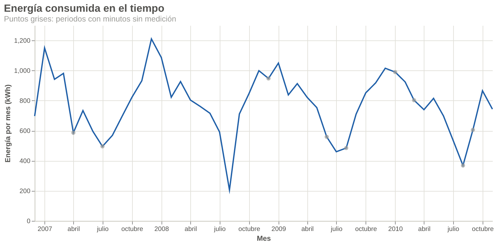
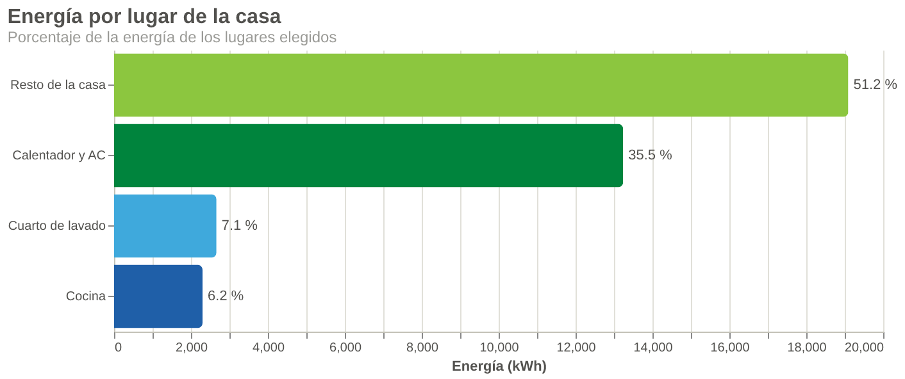
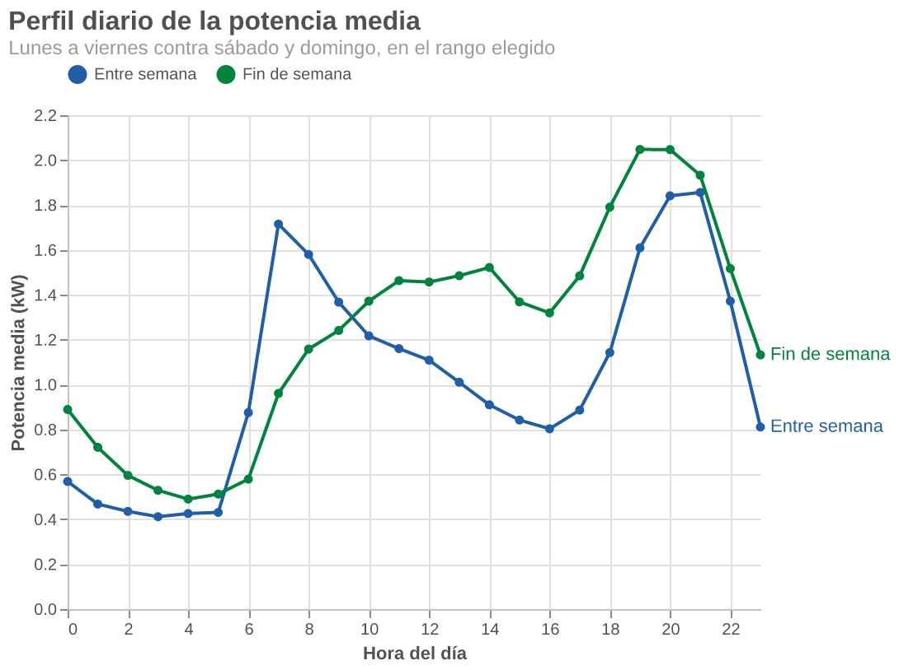
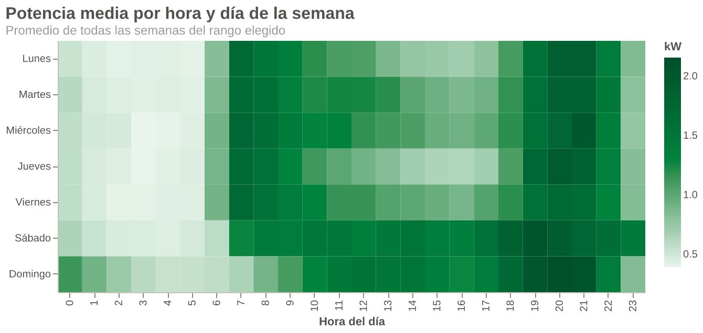
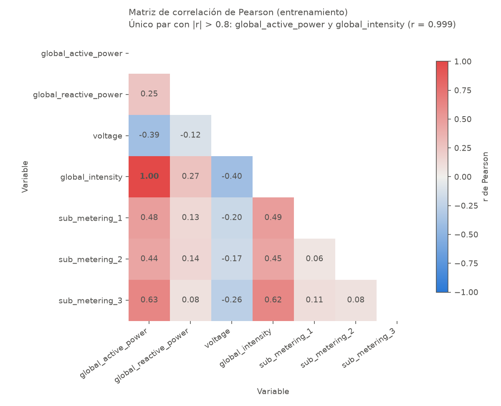
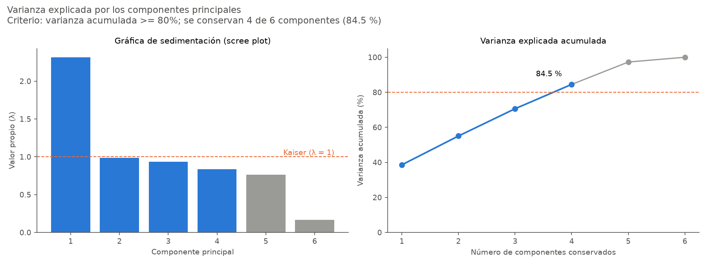
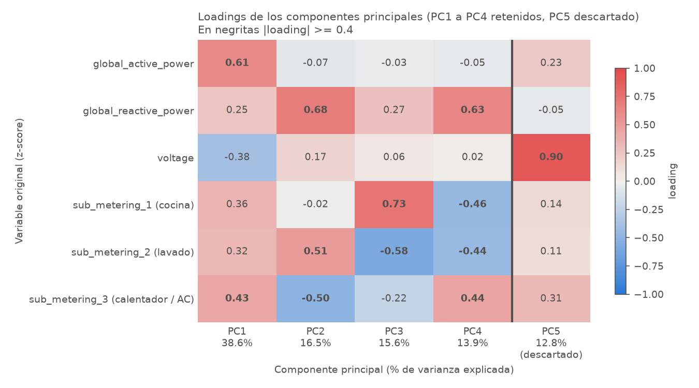

## Contexto: un hogar medido minuto a minuto durante casi 4 años {.smaller}

:::: {.columns}
::: {.column width="52%"}
| Característica | Valor |
|---|---|
| Origen | UCI Machine Learning Repository: un hogar en Sceaux, Francia |
| Tamaño | 2,075,259 registros · 9 columnas · 133 MB |
| Periodo | 16/12/2006 a 26/11/2010 (47.3 meses) |
| Frecuencia | 1 minuto, sin minutos ausentes en la rejilla |
| Faltantes | 25,979 filas (1.25 %), marcadas con `?` |
| Tareas asociadas | Regresión y agrupamiento |
:::

::: {.column width="48%"}
**Variables** (promedio o energía por minuto):

- Potencia activa y reactiva (kW), voltaje (V), intensidad (A)
- Tres submedidores (Wh):
  - **Cocina:** lavavajillas, horno, microondas
  - **Lavado:** lavadora, secadora, refrigerador
  - **Calentador de agua y aire acondicionado**
- El **resto de la casa** se calcula: potencia × 1000 / 60 − submedidores

::: {.hallazgo}
**Naturaleza temporal:** el orden importa. La partición, la normalización y el PCA respetan la cronología (80 % pasado para ajustar, 20 % futuro para probar).
:::
:::
::::

[Fuente: ficha de UCI y `src/eda/inspeccion.py`]{.fuente}

## Preprocesamiento (1/2): nombres, tipos y duplicados {.smaller}

| Paso | Qué se hizo | Resultado |
|---|---|---|
| **Normalización cualitativa** | El dataset no tiene campos de texto con valores, así que se normalizan los **nombres de columna**: minúsculas, sin espacios | `Global_active_power` → `global_active_power` |
| **Casteo de tipos** | `Date` + `Time` → una columna `datetime`; las 7 variables, de texto a número decimal | Se puede ordenar, restar y agrupar por hora, día o mes |
| **Deduplicación** | Criterio: `datetime` es la llave (un registro por minuto); si se repite, se conserva el primero | **0 filas eliminadas**: no hay minutos repetidos |

::: {.hallazgo}
El archivo ya venía ordenado y sin duplicados. El paso de deduplicación se conserva en el pipeline para que siga siendo correcto si el archivo cambia.
:::

[Fuente: `src/eda/inspeccion.py` §3-4 y `src/cleaning/preprocessing.py`]{.fuente}

## Preprocesamiento (2/2): los faltantes están concentrados en pocos apagones {.smaller}

:::: {.columns}
::: {.column width="55%"}
Los 25,979 minutos sin medición forman **71 rachas**; en cada una faltan las 7 variables a la vez.

| Racha | Rachas | Filas | Tratamiento |
|---|---|---|---|
| Hasta 60 min | 62 (87.3 %) | 288 (1.1 %) | **Interpolación lineal** en el tiempo · bandera `interpolado` |
| Más de 60 min | 9 (12.7 %) | 25,691 (98.9 %) | **Se dejan vacías** · bandera `medicion_faltante` |

- 2010 concentra el **68 %** de los faltantes.
- No se elimina ninguna fila: la serie conserva un registro por minuto.
:::

::: {.column width="45%"}
**Por qué esta estrategia híbrida**

- **Huecos cortos:** los minutos vecinos son la mejor referencia de lo que pasó dentro del hueco.
- **Apagones largos** (1 a 5 días): una recta de varios días borraría el ciclo día/noche. Imputarlos inventaría datos justo en el periodo de prueba.
- Los pasos que necesitan filas completas (escalador, Pearson, PCA) **excluyen** los apagones.
:::
::::

[Fuente: `src/eda/inspeccion.py` §5 y `src/cleaning/preprocessing.py`]{.fuente}

## Hallazgos (1/3): en invierno el hogar consume casi el doble que en verano {.smaller}

:::: {.columns}
::: {.column width="60%"}

:::

::: {.column width="40%"}
**¿Cuánta energía consume y cómo cambia?**

- **Estable entre años:** 9,714 kWh en 2007, 9,417 en 2008 y 9,373 en 2009 (1.07 a 1.12 kW de potencia media).
- **Muy estacional:** invierno (dic-feb) **1.42 kW** contra verano (jun-ago) **0.73 kW**: 1.95 veces. Diciembre es el mes más alto (1.49 kW) y agosto el más bajo (0.57 kW).
- **Agosto de 2008** es el mínimo de toda la serie (206 kWh) sin ningún apagón: probablemente el hogar estuvo desocupado (hipótesis, no se puede confirmar con los datos).

::: {.hallazgo}
**Para la compañía:** la demanda anual es predecible; la capacidad hay que planearla para el invierno.
:::
:::
::::

[Fuente: `src/eda/hallazgos.py` §1 (periodo completo)]{.fuente}

## Hallazgos (2/3): la mitad de la energía no pasa por ningún submedidor {.smaller}

:::: {.columns}
::: {.column width="55%"}

| Estación | Cocina | Lavado | Calentador y AC | Resto |
|---|---|---|---|---|
| Invierno | 5.4 % | 6.2 % | 32.7 % | 55.7 % |
| Verano | 7.0 % | 8.4 % | 39.3 % | 45.4 % |
:::

::: {.column width="45%"}
**¿Qué lugar consume más?**

- **Resto de la casa: 51.2 %.** Más de la mitad de la energía no tiene submedidor, así que no sabemos qué dispositivos la consumen; en invierno sube a 55.7 %.
- **Calentador de agua y AC: 35.5 %**, el mayor uso **medido**: 5 a 6 veces más que la cocina (6.2 %) o el lavado (7.1 %).
- En verano el calentador y AC pesa más (39.3 %), aunque el consumo total baja.

::: {.hallazgo}
**Para la compañía:** el calentador de agua es el dispositivo identificado con más impacto para programas de eficiencia; el 51 % sin submedidor es un punto ciego que conviene medir.
:::
:::
::::

[Fuente: `src/eda/hallazgos.py` §2 (periodo completo)]{.fuente}

## Hallazgos (3/3): de 19 a 22 h se consume el 26.5 % de la energía del día {.smaller}

:::: {.columns}
::: {.column width="40%"}
{height="340"}
:::

::: {.column width="60%"}
{height="190"}

- **Entre semana:** picos a las 7 h (1.72 kW) y 21 h (1.86 kW); valle de 0.41 kW a las 3 h (**4.5 veces** menos).
- **Fin de semana:** sin pico a las 7 h; alto desde las 11 h y pico a las 19 h (2.05 kW). Máximo: **domingo 20 h (2.16 kW)**.
- Coincide con Gasparin et al. (2019, p. 16): picos de mañana y noche, fin de semana distinto.
:::
::::

::: {.hallazgo}
**Para la compañía:** 4 horas (17 % del día) concentran el 26.5 % de la energía (60 % "resto de la casa", 25 % calentador y AC). Una tarifa horaria podría mover consumo fuera de 19 a 22 h. [Fuente: `src/eda/hallazgos.py` §3]{.fuente}
:::

## Normalización: z-score, ajustado solo con el pasado {.smaller}

:::: {.columns}
::: {.column width="50%"}
**Por qué z-score y no min-max**

1. **El PCA exige la misma varianza** en todas las variables. Con min-max la desviación estándar queda entre **0.07 y 0.272**; con z-score todas quedan en **1.0**.
2. **Hay atípicos y son consumo real:** seis de las 7 variables tienen entre **2.0 % y 8.3 %** de atípicos (1.5·IQR). Min-max es más sensible a ellos.
3. **No exige normalidad:** solo `voltage` tiene forma de campana.

Escalador robusto descartado: `sub_metering_1` tiene **IQR = 0**.
:::

::: {.column width="50%"}
**Cómo se aplicó**

- Corte cronológico **80 / 20**: la prueba inicia el **11/02/2010 15:31**.
- Media y desviación calculadas **solo con entrenamiento**, aplicadas a todo el dataset: así no se filtra información del futuro.
- Verificación: entrenamiento con media 0 y std 1; en prueba la media va de −0.10 a 0.16 (el futuro se aleja del pasado).
- Parámetros guardados en `scaler_params.csv` para escalar datos nuevos y revertir.
:::
::::

[Fuente: `src/eda/distribuciones.py` y `src/cleaning/normalization.py`]{.fuente}

## Pearson: solo un par es redundante; se descarta global_intensity {.smaller}

:::: {.columns}
::: {.column width="55%"}
{height="450"}
:::

::: {.column width="45%"}
- **Umbral |r| > 0.8** (criterio de la teoría: "muy fuerte, candidata a redundancia").
- De 21 pares, solo `global_active_power` y `global_intensity`: **r = 0.999**, IC 95 % [0.999, 0.999]. El siguiente par: r = 0.631.
- El valor p es 0 en los 21 pares: con 1.6 millones de minutos todo es "significativo". Se decide con la **magnitud** y su intervalo.

::: {.hallazgo}
**Se descarta `global_intensity`:** la potencia activa se convierte en energía (kWh) y la intensidad es la potencia dividida entre un voltaje casi constante. **Quedan 6 variables.**
:::
:::
::::

[Fuente: `src/reduction/correlation.py` (entrenamiento, 1,649,006 minutos)]{.fuente}

## PCA: 4 componentes conservan el 84.5 % de la varianza {.smaller}

:::: {.columns}
::: {.column width="50%"}

- **Criterio:** varianza acumulada ≥ 80 %. Kaiser (λ > 1) daría 1 componente (38.6 %).
- **PC5 se descarta:** es básicamente el voltaje (loading 0.90), que sigue en el dataset como variable.
:::

::: {.column width="50%"}

| Componente | Representa |
|---|---|
| PC1 (38.6 %) | Nivel de consumo total |
| PC2 (16.5 %) | Lavado frente a calentador / AC |
| PC3 (15.6 %) | Cocina frente a lavado |
| PC4 (13.9 %) | Reactiva y calentador frente a cocina y lavado |
:::
::::

[Fuente: `src/reduction/pca.py`; ajustado solo con entrenamiento]{.fuente}

## Conclusiones {.smaller}

:::: {.columns}
::: {.column width="50%"}
**Del proceso**

- **Dataset final:** `consumo_preparado.csv`, 2,075,259 filas × 14 columnas: 6 variables en z-score, banderas de calidad, conjunto train/test y PC1 a PC4.
- Los faltantes se concentran en 9 apagones; se marcan en lugar de inventarse.
- Solo una variable era redundante, y por eso el PCA comprime poco (de 6 a 4 columnas): las demás aportan información distinta.
- Todo se reproduce con 6 scripts en orden, sin modificar el archivo original.
:::

::: {.column width="50%"}
**Para la compañía eléctrica**

- **Situación:** el hogar consume unos 9,400 kWh al año, estable entre 2007 y 2009.
- **Complicación:** la demanda no es pareja: casi el doble en invierno y el 26.5 % en solo 4 horas de la noche (19 a 22 h).
- **Pregunta:** ¿dónde actuar para aplanar la demanda?
- **Respuesta:** en la franja de 19 a 22 h y en invierno. El calentador de agua (35.5 %, el mayor uso medido) es candidato a programarse fuera del pico, y conviene submedir el 51 % que hoy no se identifica.
:::
::::
